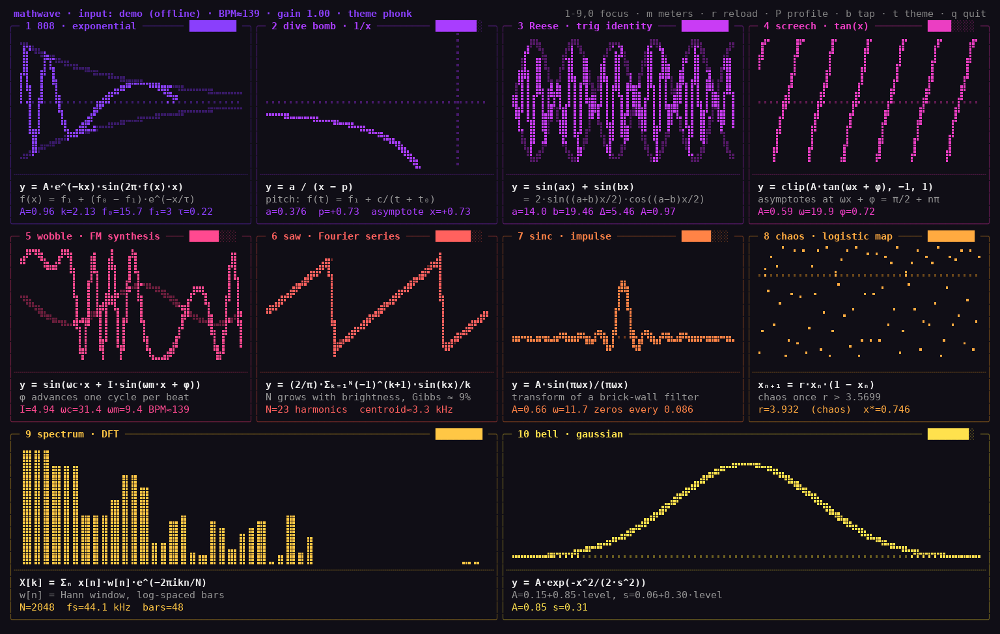
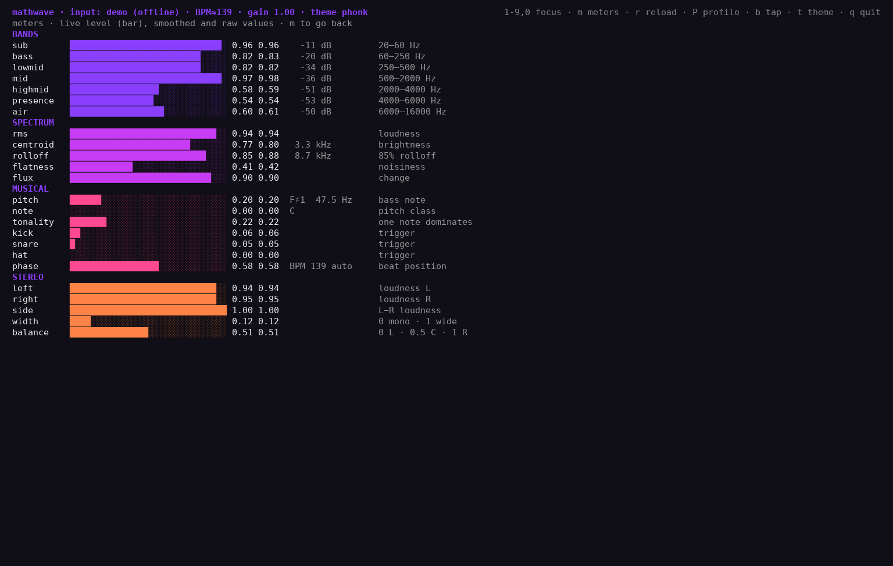

# mathwave

A Cava-style terminal visualizer for Arch Linux. It listens to whatever your system is playing and drives a grid of math functions with it. Every panel plots one formula, the music moves the formula's parameters, and the formula is printed under the plot with its live values.

The idea comes from the "math functions that go hard" reels: an 808 from an exponential, a dive bomb from 1/x, a Reese from a trig identity, a screech from tan(x). mathwave runs that in reverse. Instead of turning formulas into sound, it turns sound back into the formulas.



## Panels

| # | Key | Formula plotted | Driven by |
|---|-----|-----------------|-----------|
| 1 | `808` | `y = A·e^(−kx)·sin(2π·f(x)·x)`, `f(x) = f₁ + (f₀ − f₁)·e^(−x/τ)` | sub 20–60 Hz, redrawn on every kick |
| 2 | `dive` | `y = a / (x − p)` | bass 60–250 Hz, asymptote sweeps on the beat |
| 3 | `reese` | `sin(ax) + sin(bx) = 2·sin((a+b)x/2)·cos((a−b)x/2)` | low mids 250–500 Hz set the detune |
| 4 | `tan` | `y = clip(A·tan(ωx + φ), −1, 1)` | presence 4–6 kHz |
| 5 | `fm` | `y = sin(ωc·x + I·sin(ωm·x + φ))` | high mids 2–4 kHz set the index, tempo sets φ |
| 6 | `saw` | `y = (2/π)·Σₖ₌₁ᴺ(−1)^(k+1)·sin(kx)/k` | brightness (spectral centroid) sets N |
| 7 | `sinc` | `y = A·sin(πωx)/(πωx)` | air 6–16 kHz |
| 8 | `logistic` | `xₙ₊₁ = r·xₙ·(1 − xₙ)` | loudness sets r, so loud passages go chaotic |
| 9 | `spectrum` | `X[k] = Σₙ x[n]·w[n]·e^(−2πikn/N)` | the classic Cava bars |

Each panel's title bar has a level meter for its drive signal. Dim curves are guides: envelopes, asymptotes, the ideal saw, the logistic fixed point.

## Install

```sh
git clone https://github.com/drowsyclimber/mathwave.git
cd mathwave/packaging
makepkg -si
```

That builds whatever is in your checkout, including local edits. Or download the prebuilt `.pkg.tar.zst` from the [latest release](https://github.com/drowsyclimber/mathwave/releases/latest) and run `sudo pacman -U` on it.

Runtime dependencies are `python` and `python-numpy`. For capture you need one of `libpulse` (provides `parec`, works with pipewire-pulse) or `pipewire` (provides `pw-record`). Most Arch desktops already have both.

`packaging/PKGBUILD.aur` builds a tagged GitHub release (this is the AUR package) and `packaging/PKGBUILD-git` builds the latest commit on `main`.

## Use

```sh
mathwave                      # capture the default output's monitor, like cava
mathwave --demo --audible     # play the built-in track (every sound is a formula) and watch it
mathwave --panels 808,dive,reese,tan --layout 2x2
mathwave --focus 3            # start with the Reese panel full screen
mathwave --formulas           # print every formula, its drive and what it sounds like
mathwave --list-features      # every band and feature you can drive a panel with
mathwave --meters             # start in the live meter view
mathwave --profile phonk      # start with a config profile
mathwave --bpm 140            # fix the tempo instead of detecting it
mathwave --render-wav demo.wav  # the demo track as a stereo WAV
mathwave -i fifo --fifo /tmp/mpd.fifo
```

Keys (also `mathwave --keys`):

| Key | Does |
|---|---|
| `1`–`9`, `0` | full-screen a panel (shows the sound, drive and tuning too); `0` is panel 10; the same key again or `g` returns |
| `m` | live meter view of every band and feature, with dB, Hz and note names |
| `r` | reload the config |
| `P` | cycle config profiles (Shift+P) |
| `b` | tap tempo; `B` goes back to the configured or detected tempo |
| `f` | cycle formula detail |
| `t` | next theme |
| `+` / `-` | gain |
| `p`, space | pause |
| `q`, Esc | quit |

Themes: `phonk`, `ocean`, `ember`, `matrix`, `mono`, `wal`, which reads `~/.cache/wal/colors.json` so it follows a pywal-based Hyprland rice, and `chroma`, which recolors everything by the note that is playing (C is red, and the hue goes round the color wheel to B).

## Config

Copy `/usr/share/doc/mathwave/config.example` to `~/.config/mathwave/config`. The first sections mirror Cava's: `[general]`, `[input]`, `[color]`, `[smoothing]`. Then come `[analysis]`, `[bands]`, `[onsets]` and `[tempo]`, covered under [Frequencies and features](#frequencies-and-features). Every key in the shipped file is commented with what it does.

You can add your own function panels. The shipped config already enables one, a Gaussian bell driven by bass, as panel 10:

```ini
[general]
panels = 808, dive, reese, tan, fm, saw, sinc, logistic, spectrum, bell

[panel.bell]
title = bell · gaussian
expr = A*exp(-x^2/(2*s^2))
params = A = 0.15 + 0.85*level, s = 0.06 + 0.30*level
domain = -1, 1
yrange = -0.05, 1.05
drive = bass
```

Louder bass makes the bell taller (A) and wider (s). The panel prints `y = A·exp(-x^2/(2·s^2))` with the live A and s values. `level` is the panel's drive after any `[tune.bell]` shaping, so custom panels tune the same way as built-ins.

## Per-panel tuning

Every panel, built-in or custom, can have a `[tune.<panel>]` section. Press `r` while mathwave runs to reload the config and see the change immediately. Full-screen a panel (`1`–`9`, `0`) to see its live level and active tuning.

```ini
[tune.808]
drive = sub          # what it listens to: a band, rms, centroid, or max(sub, 0.7*bass)
curve = 2            # 1 linear, 2 punchier, 0.5 more sensitive
decay = 0.85         # this panel's own fall speed
tau = 0.3            # an 808 knob: the pitch-drop time in its formula
reveal = 0.25        # an 808 knob: how fast the curve redraws after each kick
```

Keys every panel accepts, applied in this order:

| Key | Effect | Default |
|---|---|---|
| `drive` | what the panel listens to | per panel (see `--list-knobs`) |
| `gain` | multiply the level | 1 |
| `threshold` | ignore anything below this, 0..1 | 0 |
| `curve` | exponent on the level | 1 |
| `min`, `max` | the range the panel moves within (min > max inverts) | 0, 1 |
| `attack`, `decay` | this panel's own smoothing | the `[smoothing]` values |

Each built-in also has knobs for the constants in its own formula, such as `index_max` and `beats` on the FM wobble or `r_min` and `r_max` on the logistic map. `mathwave --list-knobs` prints all of them with defaults and descriptions, and the shipped config has a commented example for every panel. A typo in a key is rejected with a suggestion, for example `unknown key 'freqmax' (did you mean freq_max?)`.

A knob can also be an expression, so a formula constant can follow the music directly:

```ini
[tune.reese]
a = 8 + 16*pitch     # the base frequency follows the bass note
```

Expressions are checked before they run: only arithmetic, numeric constants, drive names (`mathwave --list-features`), `t`, `beat`, `band()`, `peak()` and a fixed list of math functions are allowed.

## Frequencies and features

`m` opens the meter view, which is the quickest way to see what each drive is doing before you point a panel at it.



### Bands

The seven built-in bands are `sub` 20–60, `bass` 60–250, `lowmid` 250–500, `mid` 500–2000, `highmid` 2–4k, `presence` 4–6k and `air` 6–16k Hz. Add your own, or redefine a built-in, in `[bands]`:

```ini
[bands]
kickband = 40-90 peak range=25
snarebody = 180-300 peak
bass = 50-200
```

After the range, `peak` uses the loudest bin instead of the average, which is tighter for kicks and single notes. `range=`, `floor=` and `fall=` give the band its own dynamic range, noise floor and peak fall rate in dB. `fft=` gives it its own FFT size. `norm=shared` scales a group of bands together so their relative loudness survives, instead of each one filling 0..1 on its own.

For a one-off you can skip the section and write a band inline: `drive = band(40, 90)` or `drive = max(kick, peak(40, 90))`.

### Weighting and resolution

Music has much less energy at the top than the bottom. `tilt = 3` under `[analysis]` adds 3 dB per octave above 1 kHz (and takes it away below), or `weighting = a` applies the A-weighting curve, so the high bands move as much as the bass.

A single FFT size is a trade between bass detail and speed. `multires = on` gives bands below `split_hz` (250 Hz) an 8192-point FFT, which separates 40 Hz from 55 Hz, and bands above it a 1024-point FFT, which reacts in 23 ms.

### Features

| Drive | What it measures |
|---|---|
| `rms` | loudness |
| `centroid` | brightness, the spectrum's center of mass |
| `rolloff` | where the highs end (85% of the spectrum is below it) |
| `flatness` | noisiness: 0 for a pure tone, 1 for white noise |
| `flux` | how fast the spectrum is changing |
| `pitch` | the bass note within `pitch_range` (30–300 Hz), on a log scale |
| `note`, `tonality` | the dominant pitch class (C=0 to B=1) and how strongly it dominates |
| `kick`, `snare`, `hat` | triggers that jump to 1 on a hit and decay over `envelope_ms` |
| `phase` | position in the current beat, 0..1 |
| `left`, `right`, `side` | channel loudness and the loudness of L minus R |
| `width`, `balance` | 0 mono to 1 out of phase; 0 hard left, 0.5 center, 1 hard right |

The triggers are tuned in `[onsets]`, where each one takes frequency ranges joined with `+` (`snare = 180-400 + 2000-5000`), plus `sensitivity`, `refractory_ms` and `envelope_ms`. A hit only counts when its own ranges get more new energy than a reference region, so a snare's noise does not fire the kick and a kick does not fire the hats.

### Tempo

`[tempo]` sets `bpm = auto` (detected from kicks) or a fixed number, a `multiplier` for double or half time, and the `range` that detected tempos fold into, so a 168 BPM track can read as 84 if you prefer. In the app, tap `b` on the beat to set the tempo by ear and `B` to go back. The status line shows where the tempo comes from.

### Smoothing in milliseconds

`attack` and `decay` act per frame, so they feel different at 30 and 144 fps. `attack_ms` and `decay_ms` set the time to cover 90% of a change instead, and feel the same at any frame rate. `hold_ms` holds each peak before it falls. All three also work per panel in `[tune.<panel>]`.

### Profiles

Any section name can end in `@NAME`. Those keys apply only when that profile is active and are merged over the plain section, so a profile only lists what it changes:

```ini
[tune.808@phonk]
gain = 1.6

[tempo@phonk]
bpm = 140

[smoothing@chill]
decay_ms = 700
```

Pick one with `--profile phonk` or `profile = phonk` under `[general]`, or press Shift+P to cycle through them while it runs.

## How it works

1. Capture: `parec --device=@DEFAULT_MONITOR@` or `pw-record -P '{ stream.capture.sink = true }' -` streams raw 16-bit PCM into a ring buffer. `--raw` is passed to `pw-record` only on PipeWire versions that support it.
2. Analysis: a 2048-point Hann-windowed FFT every frame, plus an 8192-point one for pitch and chroma and any extra sizes your bands ask for. Each band is converted to dB, optionally tilted or A-weighted, and normalized against its own recent peak with a 40 dB window, so quiet bands still move but silence reads as zero. Kick, snare and hat onsets come from spectral flux in their ranges, and the spacing between kicks gives the BPM. Pitch uses weighted subharmonic summation, so a bass note with a weak fundamental is not reported an octave up. Left and right are analyzed separately for the stereo drives.
3. Panels: each panel evaluates its drive expression, shapes it with its tuning (gain, threshold, curve, range, smoothing), maps the result onto its formula's parameters through its knobs, evaluates the formula with numpy across the panel width, and hands back curves.
4. Rendering: curves are drawn into a dot grid at 2×4 dots per character and encoded as Unicode braille, then written in one synchronized ANSI frame. Analysis takes about 1.3 ms and drawing a 168×50 grid about 5 ms per frame.

## Development

```sh
PYTHONPATH=src python -m pytest -q
PYTHONPATH=src python -m mathwave --dump 240 --at 38 --size 168x50 > frame.ans   # headless frame
```
